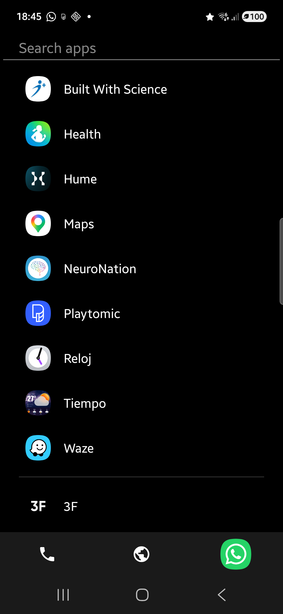
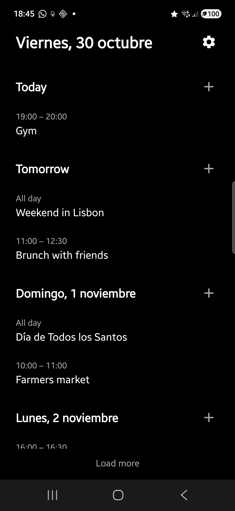

# LaunchCal

A minimal Android launcher with a built-in calendar agenda view.

## Screenshots

<p>
  
  
</p>

## Features

- App list with accent-insensitive search
- Favorites: long-press an app to add/remove it from favorites or open App info
- Calendar agenda view (swipe right from the app list) showing the next 7 days, extendable with "Load more"
- Tap an event to open it in your calendar app; quick-add events with the + button
- Choose which calendars appear in the agenda from the settings gear
- Clock with 12-hour, 24-hour or system format; tap it to open your alarms
- Bottom dock with phone, browser and camera by default; long-press a slot to pick any app or reset it
- Onboarding screen and prompt to set LaunchCal as the default launcher
- Auto-refreshes app list on install/uninstall

## Building

Requires JDK 21 and the Android SDK, both listed in `.tool-versions` and installable with [mise](https://mise.jdx.dev):

```bash
mise install
./gradlew assembleDebug
```

APK output: `app/build/outputs/apk/debug/app-debug.apk`

## Permissions

- `READ_CALENDAR` — agenda view
- `QUERY_ALL_PACKAGES` — full app list
